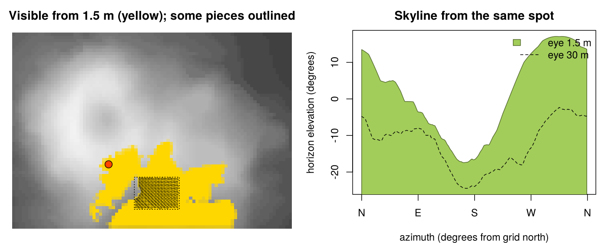
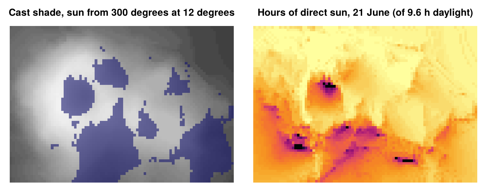

# aspersions

Cast shade and sight lines on terrain.

- **`viewshed()`**: what can be seen from a point. It's exact, on the terrain as triangles. You get the visible part
  of every triangle as a polygon, the visible fraction of each cell, and the skyline from the point.
  **`viewshed_mesh()`** does the same for any triangulation, in the front-to-back order from **`mesh_order()`**.
- **`cast_shade()`**: where the terrain shades itself for one sun position. **`sun_hours()`** gives the hours of
  direct sun over a day, and **`sun_position()`** where the sun is.

The work is done in Rust (the `osvm` crate, vendored in `src/rust/osvm`) through extendr. The same algorithms run
in the browser in [lunashade](https://github.com/mdsumner/lunashade), a sun, shade and viewshed map for the
Tasmania 2 m DEM. The two implementations are checked against each other and agree to the last digit.

## Installation

You need a Rust toolchain (`cargo`, `rustc`): see <https://rustup.rs>.

``` r
# install.packages("remotes")
remotes::install_github("hypertidy/aspersions")
```

## Grids

A grid is a matrix of heights with row 1 at the north edge, as `terra::as.matrix(x, wide = TRUE)` gives. It
needs square cells and an extent `c(xmin, xmax, ymin, ymax)` in a projected coordinate system in metres.

``` r
library(aspersions)
z <- t(volcano)[ncol(volcano):1, ]   # 61 x 87, row 1 north
ex <- c(0, 870, 0, 610)              # 10 m cells
```

## What can be seen from here

``` r
v <- viewshed(z, ex, c(300, 200), eye = 1.5)
v
#> <aspersions viewshed>
#>   eye at (300, 200), 172.5 m
#>   visible: 7.205e+04 m^2 from 1537 of 10320 triangles
#>   14.5% of the grid visible
#>   ...
head(v$pieces)      # visible polygons: x, y, piece, triangle, ring
head(v$skyline)     # azimuth (from grid north) and elevation of the horizon
```



`far` and `far_extent` add a coarser grid around `z` for terrain further out, and `curvature = TRUE` (the default)
lowers distant terrain for the curve of the earth, with standard refraction.

## Where the terrain shades itself

``` r
s <- cast_shade(z, ex, azimuth = 300, elevation = 12)               # TRUE in shadow
h <- sun_hours(z, ex, "2026-06-21", lon = 174.77, lat = -36.88,
               tz = "Pacific/Auckland", step = 5)                     # hours of direct sun
sun_position(as.POSIXct("2026-06-21 12:00", tz = "Australia/Hobart"), 147.3, -42.9)
```



## How

**Viewshed**: an object-space visibility map.

1. Around the eye there are four 90 degree wedges of azimuth. Each uses the central (gnomonic) projection, where
   straight edges stay straight, so a projected triangle is still a triangle.
2. Triangles are visited front to back. On a grid, visiting quads in order of increasing row-plus-column offset
   from the eye is already a valid order, so there's no sort. For any mesh, the order is a topological sort of
   one rule: across each shared edge, the triangle on the eye's side goes first. Delaunay meshes never produce a
   cycle; other meshes can, so cycles are detected and counted.
3. Per narrow sector of azimuth, the horizon is kept as a piecewise-linear upper envelope. A triangle is visible
   exactly where it rises above the horizon, which it then raises.
4. The visible pieces map back to the ground as convex polygons. The horizon left at the end is the skyline.

**Shade**: one directional sweep per sun position, linear in the number of cells. A "shadow surface" is carried
along the light's direction, dropping by `step * tan(elevation)` per cell. A cell is in shadow where the surface
arriving at it is above the ground.

There's a longer write-up in lunashade's
[docs/viewshed.md](https://github.com/mdsumner/lunashade/blob/main/docs/viewshed.md).

## Status

Early. The interface may change.

- Terrain only: heights are bare ground, unless you pass a surface model.
- The viewshed answers "can I see the ground there". It doesn't yet answer whether a raised target at a height
  above the ground can be seen.
- Every grid cell becomes two triangles. Level of detail by angle seen from the eye, on an adaptive Delaunay
  mesh, is the next step.
