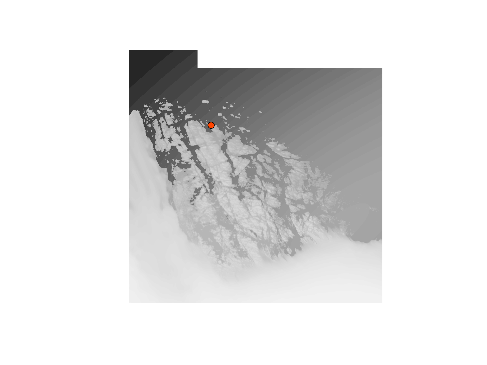
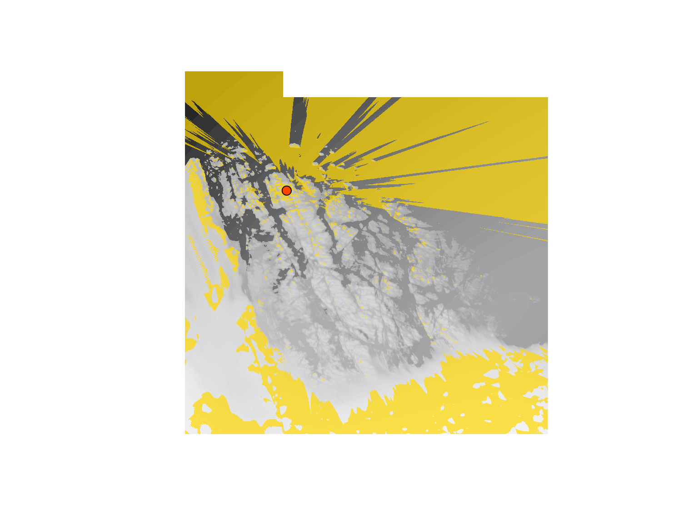
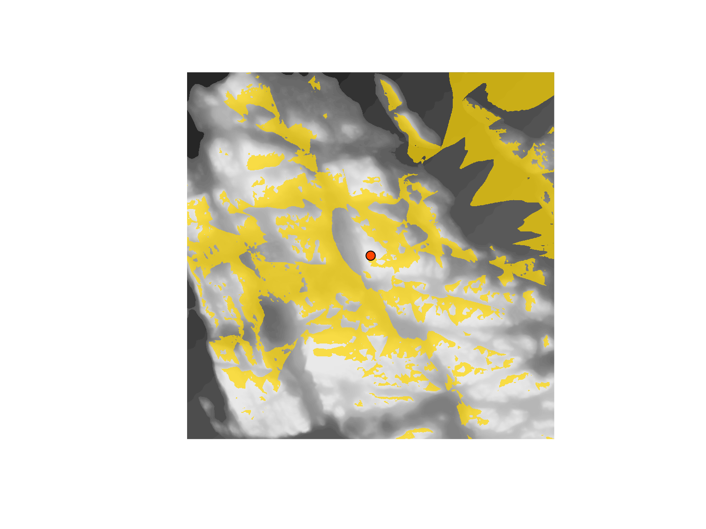
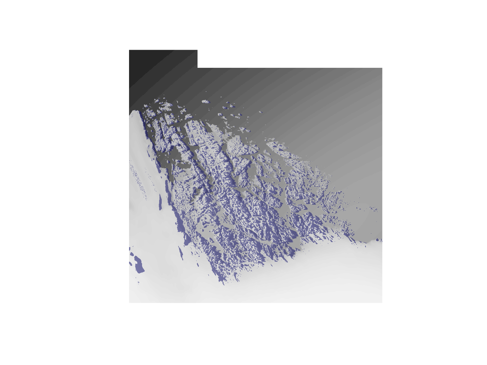
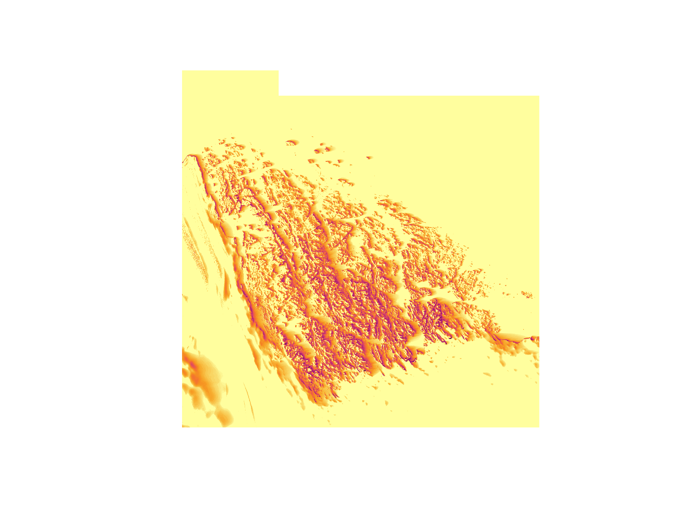

# Vestfold Hills: sight lines and midnight sun

The Vestfold Hills are a low, ice-free coastal oasis in East Antarctica,
about 400 square kilometres of rocky hills, fjords and lakes between the
ice sheet and the sea. Davis station sits on their western shore. This
page reads the terrain straight from the Reference Elevation Model of
Antarctica (REMA) with GDAL, then asks two questions of it: what can be
seen from a hill near the station, and where the low summer sun reaches
the ground.

## Reading REMA

One data source covers the continent. It’s a GDAL VRT of the 2 m REMA
tiles with overviews at 10 m, 32 m, 100 m, 500 m and 1 km. GDAL’s warper
picks the right level for the resolution asked for and reads only the
bytes it needs, so a 40 km box at 20 m costs about the same as a small
box at full detail. The same source drives a browser explorer,
<https://mdsumner.github.io/rema-ovr/>.

``` r

dsn
#> [1] "/vsicurl/https://raw.githubusercontent.com/mdsumner/rema-ovr/main/REMA-2m_dem_ovr.vrt"
## the full-resolution levels live in a public bucket, read without credentials
set_config_option("AWS_NO_SIGN_REQUEST", "YES")

## warp a box of REMA in Antarctic polar stereographic (EPSG:3031) at `res` metres
read_rema <- function(extent, res) {
  tf <- tempfile(fileext = ".tif")
  warp(dsn, tf, t_srs = "EPSG:3031",
       cl_arg = c("-te", extent[1], extent[3], extent[2], extent[4], "-tr", res, res, "-r", "bilinear"),
       quiet = TRUE)
  ds <- new(GDALRaster, tf)
  on.exit(ds$close())
  read_ds(ds)
}

davis <- c(2302286, 490792)                        # Davis station, EPSG:3031
box <- c(2289000, 2330000, 462000, 503000)        # the Vestfold Hills, 41 km square
vh <- read_rema(box, 20)
attr(vh, "gis")$dim
#> [1] 2050 2050    1
```

[`read_ds()`](https://firelab.github.io/gdalraster/reference/read_ds.html)
gives the heights with their georeferencing attached, and both ximage
and aspersions take that directly.

Heights run from sea level in the hills to over a kilometre on the ice
sheet, so the greys are spread evenly over the heights present rather
than over the range:

``` r

relief <- grey.colors(64, 0.15, 0.95)
rb <- unique(quantile(vh, seq(0, 1, length.out = 65), na.rm = TRUE))
ximage(vh, col = relief[seq_len(length(rb) - 1)], breaks = rb, asp = 1, axes = FALSE)
points(davis[1], davis[2], pch = 21, bg = "orangered", cex = 1.4)
```



## What can be seen from a hill near the station

Take the highest ground within 3 km of Davis and stand on it, with the
eye at 2 m.

``` r

z <- matrix(vh, attr(vh, "gis")$dim[2], byrow = TRUE)
ex <- attr(vh, "gis")$bbox[c(1, 3, 2, 4)]
xs <- seq(ex[1] + 10, by = 20, length.out = ncol(z))
ys <- seq(ex[4] - 10, by = -20, length.out = nrow(z))
d <- sqrt(outer((ys - davis[2])^2, (xs - davis[1])^2, "+"))
k <- which(d < 3000 & z == max(z[d < 3000], na.rm = TRUE), arr.ind = TRUE)[1, ]
lookout <- c(xs[k[2]], ys[k[1]])
lookout
#> [1] 2300490  489530
z[k[1], k[2]]
#> [1] 87.28956

v <- viewshed(vh, xy = lookout, eye = 2, pieces = FALSE)
v
#> <aspersions viewshed>
#>   eye at (2300490.0, 489530.0), height 89.3
#>   visible: 644,100,000 m^2 from 3,281,192 of 8,396,802 triangles
#>   40.7% of the grid visible
#>   skyline: -0.4 to 0.9 degrees
ximage(vh, col = relief[seq_len(length(rb) - 1)], breaks = rb, asp = 1, axes = FALSE)
ximage(v$visible, extent = v$extent, add = TRUE,
       col = c("transparent", adjustcolor("gold", 0.7)), breaks = c(-1, 0.01, 2))
points(lookout[1], lookout[2], pch = 21, bg = "orangered", cex = 1.4)
```



The skyline from the lookout comes out of the same calculation:

``` r

par(mar = c(4, 4, 1, 1))
plot(v$skyline, type = "l", xaxt = "n", xlab = "azimuth (degrees from grid north)",
     ylab = "horizon (degrees)")
axis(1, at = seq(0, 360, by = 90))
abline(h = 0, lty = 3)
```


### In detail: 2 m near the lookout

The full-resolution tiles come through the same source. Here a 4 km
square around the lookout is read at 2 m, with the 20 m grid behind it
for the terrain further out. The near grid is four million cells, so
eight million triangles. The visible polygons aren’t needed here, so
`pieces = FALSE` skips collecting them.

``` r

near_box <- c(lookout[1] - 2000, lookout[1] + 2000, lookout[2] - 2000, lookout[2] + 2000)
near <- read_rema(near_box, 2)
vn <- viewshed(near, xy = lookout, eye = 2, far = z, far_extent = ex, pieces = FALSE)
vn
#> <aspersions viewshed>
#>   eye at (2300490.0, 489530.0), height 90.1
#>   visible: 647,600,000 m^2 from 5,794,800 of 16,308,804 triangles
#>   31.3% of the grid visible
#>   skyline: -0.4 to 1.0 degrees
nb <- unique(quantile(near, seq(0, 1, length.out = 65), na.rm = TRUE))
ximage(near, col = relief[seq_len(length(nb) - 1)], breaks = nb, asp = 1, axes = FALSE)
ximage(vn$visible, extent = vn$extent, add = TRUE,
       col = c("transparent", adjustcolor("gold", 0.7)), breaks = c(-1, 0.01, 2))
points(lookout[1], lookout[2], pch = 21, bg = "orangered", cex = 1.4)
```



## Midnight sun

Davis is at 68.6 degrees south, inside the Antarctic Circle: around
midsummer the sun doesn’t set, and around midwinter it doesn’t rise.
Polar stereographic grid north isn’t true north. At any point, true
north points directly away from the pole, so the grid azimuth of true
north is the longitude, about 78 degrees here. That’s the `convergence`
argument.

``` r

lonlat <- c(77.967, -68.577)
times <- as.POSIXct("2026-12-21 00:00", tz = "Antarctica/Davis") + (0:23) * 3600
round(sun_position(times, lonlat[1], lonlat[2])$elevation, 1)
#>  [1]  4.2  2.7  2.3  3.2  5.4  8.6 12.8 17.7 23.0 28.5 33.7 38.4 42.1 44.3 44.8
#> [16] 43.5 40.5 36.4 31.4 26.0 20.5 15.4 10.8  7.0
```

At local midnight on midsummer’s day the sun is low in the south, and
the hills throw long shadows:

``` r

p <- sun_position(as.POSIXct("2026-12-21 00:00", tz = "Antarctica/Davis"), lonlat[1], lonlat[2])
p
#>    azimuth elevation
#> 1 204.1893  4.211629
s <- cast_shade(vh, azimuth = p$azimuth, elevation = p$elevation, convergence = lonlat[1])
ximage(vh, col = relief[seq_len(length(rb) - 1)], breaks = rb, asp = 1, axes = FALSE)
ximage(s * 1, extent = attr(s, "extent"), add = TRUE, col = c("transparent", adjustcolor("midnightblue", 0.55)))
```



Over the whole day there are 24 hours of daylight. Terrain takes some of
them away, most in the valleys and on the slopes facing the pole:

``` r

h <- sun_hours(vh, date = "2026-12-21", lon = lonlat[1], lat = lonlat[2],
               tz = "Antarctica/Davis", step = 10, convergence = lonlat[1])
attr(h, "daylight")
#> [1] 24
summary(as.vector(h))
#>    Min. 1st Qu.  Median    Mean 3rd Qu.    Max.     NAs 
#>   7.167  22.167  24.000  22.729  24.000  24.000  216775
ximage(h, extent = attr(h, "extent"), col = hcl.colors(64, "Inferno"), asp = 1, axes = FALSE)
```



## Notes

- REMA is a surface model of snow, ice and rock. Over open water it has
  no data. For the line of sight and the shadows that counts as 0 m, so
  water doesn’t block anything, and it stays missing in the results.
- The 20 m and 2 m grids here are resampled from REMA’s 32 m and 2 m
  levels by GDAL’s warper with bilinear resampling.
- The browser explorer for the same data source, with hillshade,
  profiles and per-level drill-down, is at
  <https://mdsumner.github.io/rema-ovr/>.
